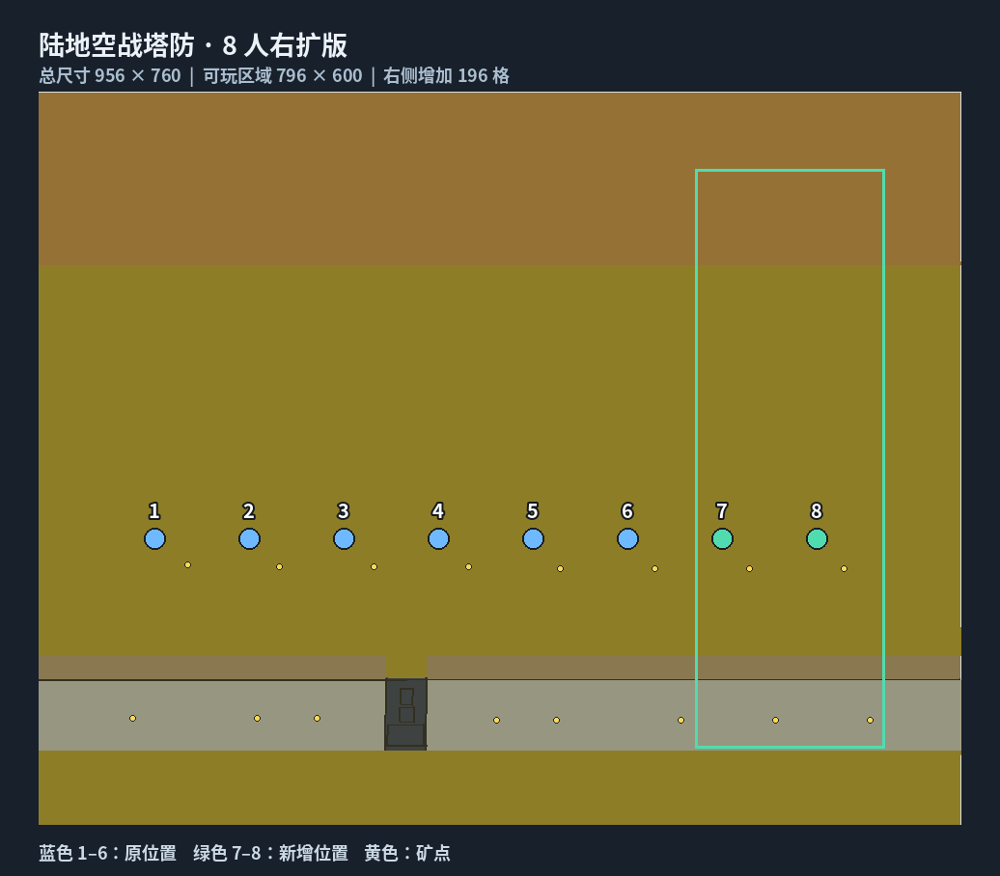

# 陆地空战塔防 1.3 · 8 人右扩版

基于用户提供的 `[cor]陆地空战塔防1.3(食堂作)_mix.zip`，使用 [dreamness-dnalm/Ra3MapSharp](https://github.com/dreamness-dnalm/Ra3MapSharp) 解析和修改。原地图作者：伟大的食堂；原作者署名和 `map.str` 文本保留。

[下载地图压缩包](land-air-defense-8p.zip) · [修改工具源码](../Tools/air-defense-8p/) · [验证报告](validation.json)

## 改动内容

| 项目 | 原图 | 8 人版 |
| --- | --- | --- |
| 总网格尺寸 | 760 × 760 | 956 × 760 |
| 可玩网格尺寸 | 600 × 600 | 796 × 600 |
| 边界宽度 | 80 | 80 |
| 玩家出生点 | 6 | 8 |
| 多人位置记录、功能热点 | 各 6 | 各 8 |
| 矿点 | 12 | 16 |
| 地图对象 | 366 | 446 |
| 队伍记录 | 330 | 430 |
| 脚本 | 275 | 306 |
| 触发区域 | 7 | 9 |

- 向右增加 196 格（1960 世界单位），复制原右侧两条线路的高度、纹理和全部通行/建造等标志，校正纹理相位。原左侧地形逐格保留。
- 第 7、8 位出生点分别为 `(6280, 2160)`、`(7260, 2160)`，沿用 980 世界单位间距。补齐矿点、前哨站、防空、天灯、隐藏检测器和对应队伍。
- 新增两条线路的进攻/传送路径点、敌军及 Boss 模板、航母组件和运输机乘员。共新增 80 个对象，其中 12 个路径点。
- 新增 `Player7Zone`、`Player8Zone`，将右边界 `DeathZone`、横向道路右端点及边界路径点向右移动 1960。
- 新增 31 个线路/玩家脚本、81 条共享动作，扩展 26 段 Lua。覆盖收入、奖励经济、补贴入口、独立救援、失败判定、敌军生成、Boss 行为及热点绑定。
- 玩家循环扩至 8 路，矿点恢复从 12 个扩至 16 个，Lua 横向坐标上限扩至 7960，越界夹取值为 7910。
- 修正扩展涉及的第 10 波奖励援军队伍后缀冲突和磁弩第七次召唤队伍引用，补齐第八次召唤与激活。
- 更新地图包名称、8 人标记、尺寸、地图 MD5、坐标信息和预览图。预览依据实际地图数据重绘，沿用原包 PNG 编码的 `.tga` 文件约定。

## 安装与运行范围

解压压缩包，将整个 `[cor]陆地空战塔防1.3(食堂作)_mix_8p` 文件夹放入地图目录（通常为 `%APPDATA%\Red Alert 3\Maps\`），确保文件夹名与 `.map` 文件名一致。

此包包含 8 路地图数据及逻辑。联机大厅和游戏引擎仍须支持 8 人槽位；地图文件本身不能解除原版《红警 3》的 6 人上限。沿用原图所需的日冕单位及 Lua Bridge 运行环境。本次没有修改 SDK/引擎或执行游戏内 8 人联机测试。

## 已执行验证

- 压缩保存后用解析库重新打开，无解析错误。
- 独立二进制解析逐格核对高度和 13 个纹理/标志平面，确认左侧区域、纹理表和右侧复制结果。
- 检查 8 个出生点、16 个矿点、8 个多人位置、8 个热点、9 个区域及对象/路径点标识。
- 306 个脚本路径全部唯一；原有脚本的激活、难度、循环、顺序执行、隐藏字段和枚举参数附加值保留。
- 147 段 Lua 通过语法检查；11 个函数在模拟游戏动作/条件接口下实际执行，核对 8 路生成、目标引用、条件跳过和坐标边界。
- 原图已有的重复 `PlyrAllies/teamPlyrAllies` 记录保留，无新增重复队伍。

模拟接口验证不能代替游戏内联机实测；验证报告会单独记录继承自原图的静态引用问题。

地图 SHA256：`52492688a5f777fbac686ba73c66e4e918d3bcc101ec959a402d530c57d4ae34`。
